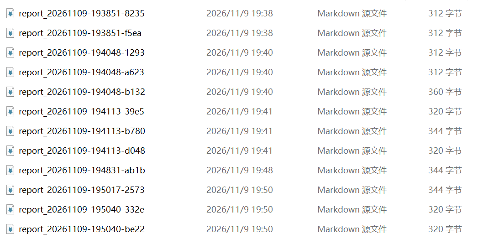
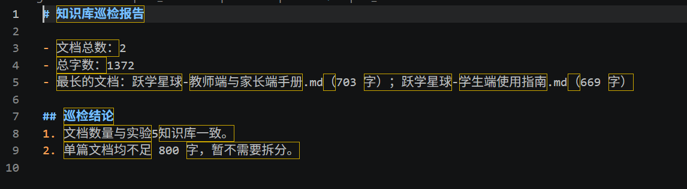
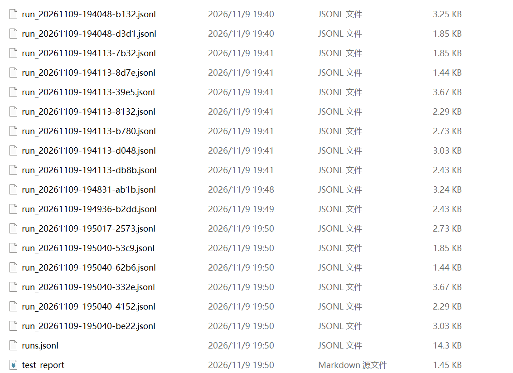
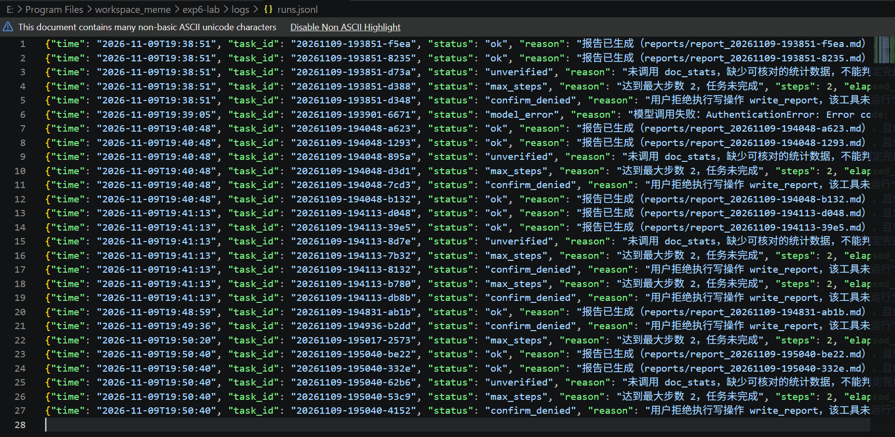
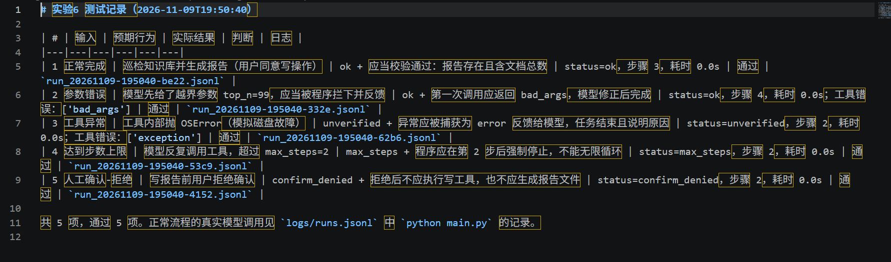

# 实验6：工具调用、Agent 与 Harness 实现

<div class="cover">

**课程实验报告**

| | |
|---|---|
| 班级 | 软工二班 |
| 学号 | 24111302092 |
| 姓名 | 丁禹 |
| 日期 | 2026-11-09 |
| 仓库 | https://github.com/luguanluguansjdl/homework_littlegame （`main` 分支 `exp6-lab/` 目录） |
| Commit | `bec4343`（`main` 分支，代码、测试、报告与截图） |

</div>

## 1. 实验目的

- 掌握工具接口定义、参数验证、权限边界和结果反馈；
- 实现一个由模型决定下一步、运行状态可查看、可终止的单 Agent；
- 编写运行时 Harness，完成上下文组织、工具执行、结果检查、停止控制与日志记录。

## 2.1 任务选择与边界

**个人软件**：本课程个人软件《跃学星球 · 声暴纪元》。本实验不直接改产品代码，而是
复用实验5的知识库文档（`knowledge/*.md`，共 2 份、1372 字）作为巡检对象，做一个
"知识库巡检助手"——任务小、数据固定、结果可程序核对，适合作为单 Agent 的练习场景。

**任务目标**：统计 `knowledge/` 下文档数量、总字数与最长文档，生成一份巡检报告
`reports/report_<任务编号>.md`。

| 项目 | 内容 |
|---|---|
| 可用数据 | `knowledge/` 下 2 个 Markdown 文档（实验5 产品手册） |
| 可用工具 | `list_docs`、`read_doc`、`doc_stats`、`write_report`（见 2.2） |
| 停止条件 | 模型给出最终回答并通过验收；或达到最大步数 6；或超过总时限 180s；或连续工具错误超 3 次；或用户拒绝确认 |
| 成功标准 | ① `doc_stats` 至少成功调用一次；② 报告文件真实存在且非空；③ 报告正文包含 `doc_stats` 返回的文档总数 |
| 输入示例 | "巡检 knowledge/ 目录下的知识库文档：统计文档总数和总字数，找出字数最多的 3 个文档，并生成巡检报告" |
| 预期结果 | 生成报告，正文含"文档总数：2""总字数：1372"及最长文档排名；运行状态 `ok` |

**哪些步骤预设、哪些由模型决定**

| 环节 | 由谁决定 |
|---|---|
| 工具清单、参数 Schema、白名单 | 程序预设（写死在 `tools.py`） |
| 循环骨架、步数/超时/重试上限 | 程序预设（`harness.py`） |
| 写操作必须人工确认 | 程序预设 |
| 成功标准与验收方式 | 程序预设（`_verify`） |
| 先调哪个工具、`top_n` 取几、要不要读细节文档、报告写什么、何时收尾 | **模型决定** |
| 工具报错后如何修正参数 | **模型决定**（程序只负责把错误回填） |

**权限三档**

| 档位 | 操作 | 实现 |
|---|---|---|
| 可自动执行 | `list_docs`、`read_doc`、`doc_stats` 等只读工具 | 校验通过即执行 |
| 必须用户确认 | `write_report`（写磁盘、会覆盖同名文件） | 执行前打印动作、目标路径、参数摘要，`y/N` 确认；拒绝或超时（空输入）即不执行 |
| 明确禁止 | 白名单外的工具名、`knowledge/` 之外的路径、绝对路径、`..` 跳转、非 `.md/.txt` 文件、直接执行模型给出的命令/代码 | `tools.py` 白名单 + `_safe_path` 校验，直接返回错误 |

## 2.2 工具接口与参数约束

**工具清单**

| 工具 | 用途 | 输入字段（类型，必填） | 返回结果 | 错误信息 |
|---|---|---|---|---|
| `list_docs` | 列出知识库文档及字数 | 无 | `{count, total_chars, docs:[{path, chars}]}` | 目录不存在 → `exception` |
| `read_doc` | 读取单个文档 | `path` (string, 必填) | `{path, chars, truncated, text}` | 路径越界 → `denied`；文件不存在 → `bad_args` |
| `doc_stats` | 统计文档规模与最长文档 | `top_n` (integer, 必填, 1-10) | `{total_docs, total_chars, top:[…]}` | 超范围 → `bad_args` |
| `write_report` | 写巡检报告（**改数据**） | `content` (string, 必填, 20-6000 字) | `{path, chars, note}` | 长度不符 → `bad_args`；用户拒绝 → 不执行 |

`doc_stats` 的 Schema（与 `tools.py` 中 `parameters` 一致）：

```json
{
  "type": "object",
  "properties": {
    "top_n": {"type": "integer", "description": "返回前多少个最长文档，1-10",
              "minimum": 1, "maximum": 10}
  },
  "required": ["top_n"],
  "additionalProperties": false
}
```

**约束如何执行**：模型只输出"工具名 + JSON 参数"，`tools.execute()` 先查白名单，
再按 Schema 逐项检查（必填、类型、`minimum/maximum`、`minLength/maxLength`、多余字段），
然后才调用真实函数。绝对路径与 `..` 一律拒绝；写工具固定写到 `reports/` 下。
模型无法让程序执行任意函数或命令。

**超时、写数据、重复调用**

| 工具 | 最长等待 | 是否修改数据 | 重复调用 |
|---|---|---|---|
| 三个只读工具 | 5s | 否 | 结果一致，幂等 |
| `write_report` | 5s | 是（写入/覆盖 `report_<任务号>.md`） | 同一任务内会覆盖，只保留最后一次；跨任务因任务号不同而互不影响 |

**上线前手工测试**：`python tools.py` 打印工具表，并依次执行 1 次正确参数
（`doc_stats(top_n=2)`）与 3 次错误参数（`top_n=99`、`path=../config.py`、未知工具
`rm_rf`）。实测输出见图 1：越界数值被 `bad_args` 拦下、`..` 跳转被判 `denied`、
未知工具被判 `unknown_tool`，均未触达真实函数。

<figure>

<figcaption>图 1　python tools.py：工具表与 1 次正确、3 次错误参数的实测</figcaption>
</figure>

## 2.3 Agent 循环与状态

**循环图**（`★` 为程序强制检查点）

```
┌────────────────────────────────────────────────┐
│ 接收目标 Harness.run(task) → system + user 消息 │
└───────────────────────┬────────────────────────┘
                        ▼
          ┌─────────────────────────────┐
          │ ★① 停止检查：步数 / 总时限   │──超限──▶ 结束：max_steps / timeout
          └──────────────┬──────────────┘
                         ▼
          ┌─────────────────────────────┐
          │ ★② 调模型（30s 超时，重试1次）│──失败──▶ 结束：model_error
          └──────────────┬──────────────┘
                         ▼
              有 tool_calls？──否──▶ ★⑤ 验收成功标准 ──▶ ok / unverified
                         │是
                         ▼
          ┌─────────────────────────────┐
          │ ★③ 白名单 + 参数 Schema 校验 │──失败──▶ 错误作为 tool 消息回填
          │ ★③' 写操作人工确认           │──拒绝──▶ 结束：confirm_denied
          └──────────────┬──────────────┘
                         ▼
          ┌─────────────────────────────┐
          │ ★④ 执行工具（5s 超时）       │──异常──▶ 错误作为 tool 消息回填
          └──────────────┬──────────────┘
                         ▼
          ┌─────────────────────────────┐
          │ 结果按 role=tool 回填上下文  │──▶ 回到 ①
          └─────────────────────────────┘
```

**步数定义**：1 步 = 1 次模型调用（该次调用请求的所有工具执行都算在这一步内）。
达到 `max_steps` 立即停止，未完成的状态记为 `max_steps`。

**上下文组织**：工具调用请求以 `assistant.tool_calls` 消息入栈，工具结果以
`{"role": "tool", "tool_call_id": …, "content": "<JSON>"}` 入栈，下一轮原样发给模型，
不是只打印在终端。日志里能看到 `model_reply` 与 `tool_result` 交替出现。

**限制**：见 2.4 表；全部由 `config.py` 常量 + `harness.py` 判断执行，提示词里虽然也写了
"最多 6 步"，但那只是提示，真正兜底的是程序。

图 2 是一次完整循环的终端输出（脚本化模型，动作序列固定，用于演示循环本身）：
第 1 步 `doc_stats` 拿到统计，第 2 步 `write_report` 触发人工确认，确认后写入，
第 3 步模型给最终回答，程序验收通过。

<figure>

<figcaption>图 2　python main.py --mock：一次完整 Agent 循环（脚本化模型）</figcaption>
</figure>

## 2.4 运行时 Harness 设计与实现

| 职责 | 模块 / 函数 | 说明 |
|---|---|---|
| 任务输入 | `main.py`（`--task`）、`Harness.run(task)` | 组装 system + user 消息 |
| 上下文 | `Harness.run` 里的 `messages` 列表 | 模型回复、工具调用、工具结果都进列表 |
| 模型调用 | `models.RealModel.chat` / `Harness._call_model` | function calling；统一超时与重试 |
| 工具分发 | `tools.execute` + `tools.TOOLS` 白名单 | 名称查表，参数校验后调用 |
| 参数与权限检查 | `tools.validate_args`、`tools._safe_path` | 类型/范围/多余字段/目录边界 |
| 人工确认 | `Harness._run_tool` → `confirm` 回调 | 写操作前打印动作与影响 |
| 结果回填 | `Harness.run` 里的 `role=tool` 消息 | 模型下一轮可见 |
| 停止控制 | `RunAborted` + 循环条件 | 5 种停止原因，均写入日志 |
| 结果检查 | `Harness._verify` | 程序核对报告文件与统计数字 |
| 日志 | `RunLogger` | 每事件一行 JSON；结束时写 `runs.jsonl` 汇总 |

**失败反馈**：工具错误以 `{"ok": false, "error_type": …, "message": …}` 回填给模型；
模型看到后自行改参数重试（用例 3 实测：`top_n=99` → 错误 → 改成 3 → 成功）；
连续错误超过 3 次则结束并记 `tool_error_limit`。

## 2.5 失败处理与可观测性

**每次运行的记录**（`logs/run_<task_id>.jsonl`，一行一事件）：

| 字段 | 含义 |
|---|---|
| `task_id` | 任务编号，形如 `20261109-202315-4765` |
| `time` / `elapsed_s` | 事件时间与相对开始的秒数 |
| `event` | `run_start` / `model_reply` / `tool_request` / `tool_result` / `confirm` / `final_answer` / `verify` / `stop` |
| `step` | 第几步 |
| `tool` / `args` | 工具名与参数摘要（截断到 200 字符，密钥正则打码为 `sk-***`） |
| `ok` / `error_type` / `message` | 工具结果与错误分类 |
| `elapsed_s` | 单次调用耗时 |

`logs/runs.jsonl` 每次运行一行汇总：状态、原因、步数、耗时、错误数、工具调用序列、报告路径。

图 3 是生成的报告文件与打开后的内容；图 4 是日志目录与 `runs.jsonl` 的汇总记录
（第 6 行即密钥停用期间的 `model_error` 记录）。

<figure>

<figcaption>图 3-1　reports/ 下生成的报告文件</figcaption>
</figure>

<figure>

<figcaption>图 3-2　报告正文：文档总数 2、总字数 1372、巡检结论</figcaption>
</figure>

<figure>

<figcaption>图 4-1　logs/ 下每次运行一个 jsonl</figcaption>
</figure>

<figure>

<figcaption>图 4-2　runs.jsonl：每次运行一行汇总（状态/原因/步数/耗时）</figcaption>
</figure>

**错误分类与处理**

| 情况 | 状态 | 处理 |
|---|---|---|
| 参数错误 | 反馈后继续 | 返回 `bad_args` 给模型，最多 3 次，之后 `tool_error_limit` |
| 工具异常 | 反馈后继续 | 捕获为 `exception`（含异常类型与消息），同上 |
| 工具超时 | 反馈后继续 | `timeout`：停止等待，**不代表后台线程已停** |
| 模型调用失败 | `model_error` | 重试 1 次（间隔 1s），仍失败则结束并记录原因 |
| 达到步数/时限 | `max_steps` / `timeout` | 立即停止，不产生报告；不重复执行已成功的写操作 |
| 用户拒绝确认 | `confirm_denied` | 写工具不执行，报告不产生 |
| 模型说"完成"但不满足标准 | `unverified` | 结束但标记未验收，理由写进日志 |

**状态不明的写操作**：`write_report` 若超时，程序不会自动重试（`MAX_TOOL_ERRORS` 内也不会
盲目重发），而是先看 `reports/` 下目标文件是否存在、大小是否非零——日志里记录的
`report_path` 就是用于核对的依据。这一点在 `Harness._verify` 中固化为"文件必须真实存在"。

**人工确认流程**：执行前打印工具名、目标路径、参数摘要 → `y/N` → 拒绝或空输入即不执行，
状态记为 `confirm_denied`，模型不会再收到成功回执。

**超时与取消能力**：模型调用由 SDK 的 `timeout` 控制；工具调用放在单线程池里
`future.result(timeout=5)`。超时只是"不再等待"，Python 无法强杀线程，后台可能仍在跑；
因此本实验把写操作排在最后一步，且写完后立即验收，避免"超时后重复写"。

## 2.6 测试与结果分析

运行环境：Python 3.15、`openai` 3.37、通义千问 `qwen-plus`（阿里云百炼 OpenAI 兼容接口）。
五类情况共 7 条记录，全部通过：

| # | 用例 | 输入 / 触发方式 | 预期行为 | 实际结果 | 判断 |
|---|---|---|---|---|---|
| 1 | 正常完成（真实模型） | 巡检任务，确认 `y` | 生成报告并通过程序验收 | `status=ok`，5 步，13.1s；`doc_stats`→`read_doc`×2→`write_report`→最终回答 | 通过 |
| 2 | 正常完成（脚本复现） | 同任务，`--mock` | 动作序列固定、可重复 | `status=ok`，3 步 | 通过 || 3 | 参数错误 | 模型给 `top_n=99` | 返回 `bad_args`，模型修正后完成 | `status=ok`，4 步，1 次 `bad_args` | 通过 |
| 4 | 工具异常 | 工具内部抛 `OSError` | `exception` 反馈给模型，结束并说明原因 | `status=unverified`，2 步 | 通过 |
| 5 | 达到步数上限 | `--max-steps 2` | 第 2 步后强制停止 | `status=max_steps`，2 步 | 通过 |
| 6 | 人工确认-拒绝 | 写报告时输入 `n` | 不执行写工具、不产生报告 | `status=confirm_denied`，2 步 | 通过 |
| 7 | 模型调用失败 | 账户侧停用密钥（复现 401） | 重试 1 次后结束并记录原因 | `status=model_error`，1 步 | 通过 |

**分析**：

- 用例 1 与用例 2 动作不同（真实模型读了 2 份文档共 5 步，脚本固定 3 步），
  说明"下一步做什么"确实由模型决定，而不是程序写死的流水线。
- 用例 3 说明错误反馈闭环有效：模型读到了 `bad_args` 文本，把 `top_n` 从 99 改成 3。
- 用例 4 说明"工具异常"与"任务未完成"是两件事：异常被正确反馈，但因为没有统计数据，
  验收判 `unverified`，而不是模型自称完成后就判成功。
- 用例 5、6 说明停止与确认规则由程序执行，与模型意愿无关；用例 7 说明模型侧失败
  也会被重试并留下 `model_error` 记录。

**局限**：

1. 未接个人软件的运行环境，巡检对象是本仓库的知识库副本，不是产品线上数据；
2. 工具超时只是停止等待，无法真正杀掉后台线程，写操作超时后的状态核对依赖人工看文件；
3. 单 Agent、单轮任务，没有多轮对话与记忆；
4. 成功标准是"报告存在 + 含文档总数"这类简单规则，复杂任务需要更细的验收规则。

**改进计划**：把 `write_report` 改为先写临时文件再原子替换，避免半写；
增加 `--dry-run` 与"时间上限"用例；把报告结构改成模板填充并在验收时校验章节完整性。

## 3 操作记录

截图均来自实际运行，按出现顺序编号；原图保存在 `图片/` 目录。

| 编号 | 文件 | 内容与说明 |
|---|---|---|
| 图 1 | `图1_python tools.py.png` | 工具表 + 1 次正确参数、3 次错误参数（`bad_args` / `denied` / `unknown_tool`） |
| 图 2 | `图2_python main.py --mock.png` | 脚本化模型的一次完整循环：3 步、确认提示、验收 ok |
| 图 3-1 | `图3_生成的巡检报告_1.png` | `reports/` 下每个任务一个报告文件 |
| 图 3-2 | `图3_生成的巡检报告_2.png` | 报告正文：文档总数 2、总字数 1372、两条结论 |
| 图 4-1 | `图4_逐事件日志_1.png` | `logs/` 下每个任务一个 `run_<id>.jsonl` |
| 图 4-2 | `图4_逐事件日志_2.png` | `runs.jsonl` 汇总：状态、原因、步数、耗时（含 401 那次 `model_error`） |
| 图 5 | `图5_五类测试结果表.png` | `run_tests.py` 生成的五类测试表（`logs/test_report.md`） |
| 图 6 | `图6_python check_key.py 的输出.png` | 密钥自检：认证成功，模型回复"成功" |
| 图 7 | `图7python main.py 的完整输出.png` | 真实模型完整运行：5 步、人工确认、`结果：ok` |

<figure>

<figcaption>图 5　run_tests.py 生成的五类测试结果表（logs/test_report.md）</figcaption>
</figure>

<figure>

<figcaption>图 6　check_key.py：密钥可用性自检</figcaption>
</figure>

<figure>

<figcaption>图 7　真实模型运行：5 步完成，写报告前人工确认，结果 ok</figcaption>
</figure>

## 4 实验小结

这次实验最直接的体会是："让模型调工具"和"让模型写答案"是两种完全不同的工程问题。
前者要回答的是——模型说要调 `doc_stats`，程序凭什么信它？本实验的答案是三层：
白名单决定"能不能调"，Schema 决定"参数合不合法"，路径解析决定"能碰到哪些文件"。
三层都在代码里，不写在提示词里，因为提示词是可以被模型"聊"过去的，而 `raise ToolError`
不会。

第二个体会是循环本身很轻，外围很重。`Harness.run` 的核心不过二十行，
但真正让它可交付的是那些"扫兴"的东西：步数上限、超时、错误计数、人工确认、
日志和验收。尤其是验收——模型在第 5 步说"报告已写入"，程序仍然去磁盘上确认文件存在、
内容里确实有 `doc_stats` 返回的数字，才判 `ok`。把"模型自称完成"和"任务真的完成"
分开，是这次最实用的一条经验。

第三个体会是边界情况比正常流程更考验设计。工具超时只是"不再等待"，线程可能还在跑；
写操作如果状态不明，先查文件再决定是否重试，而不是直接重发。这些在代码里只是几行判断，
但报告里必须写清楚，因为它们决定了这个 Agent 能不能被放心地用在实际软件上。

目前的实现是一个单 Agent、单任务的巡检小工具，局限也清楚：验收规则简单、
没有多轮对话、工具超时无法真正取消。后续如果接到《跃学星球》的实际内容流水线上，
会先补"报告结构校验"和"写操作原子化"，再考虑多工具并行。
